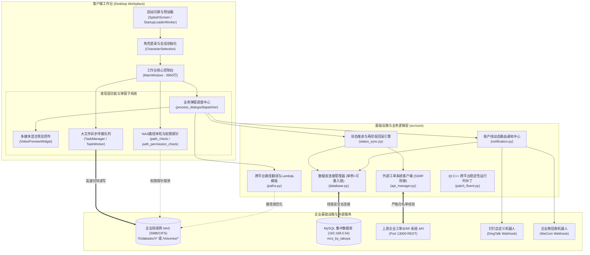
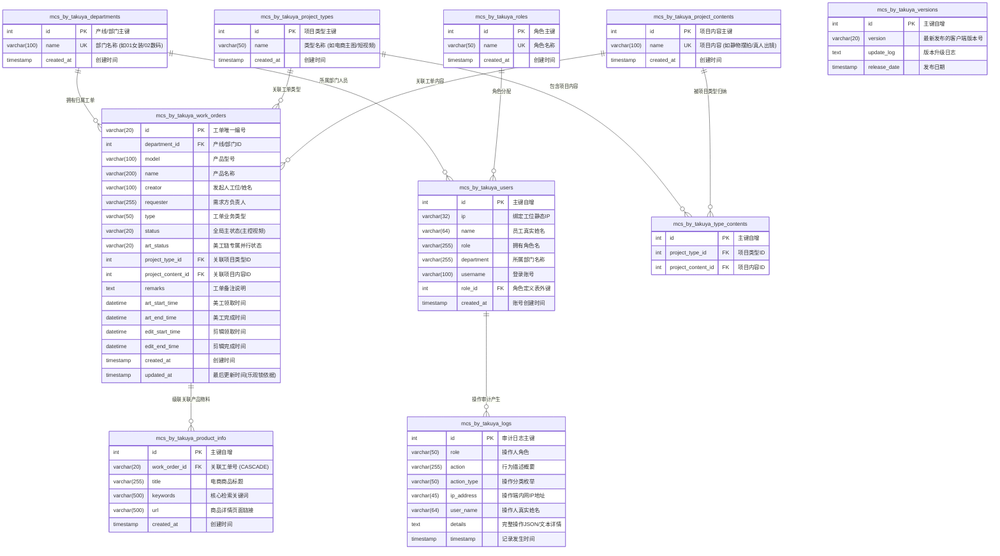
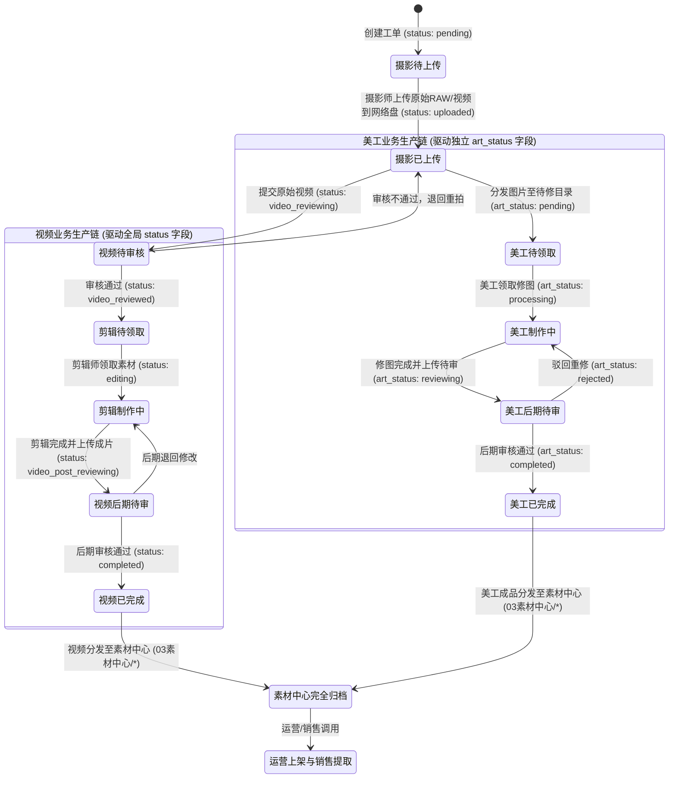
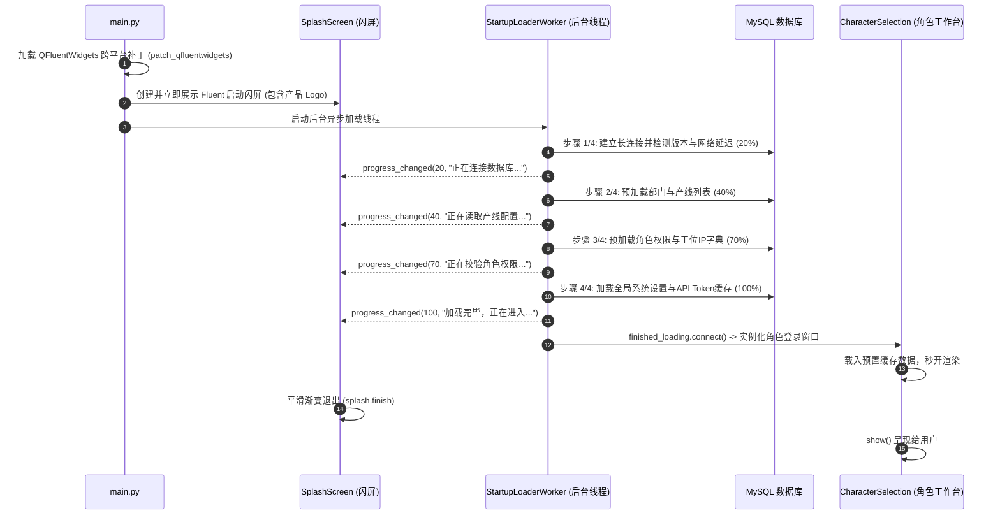
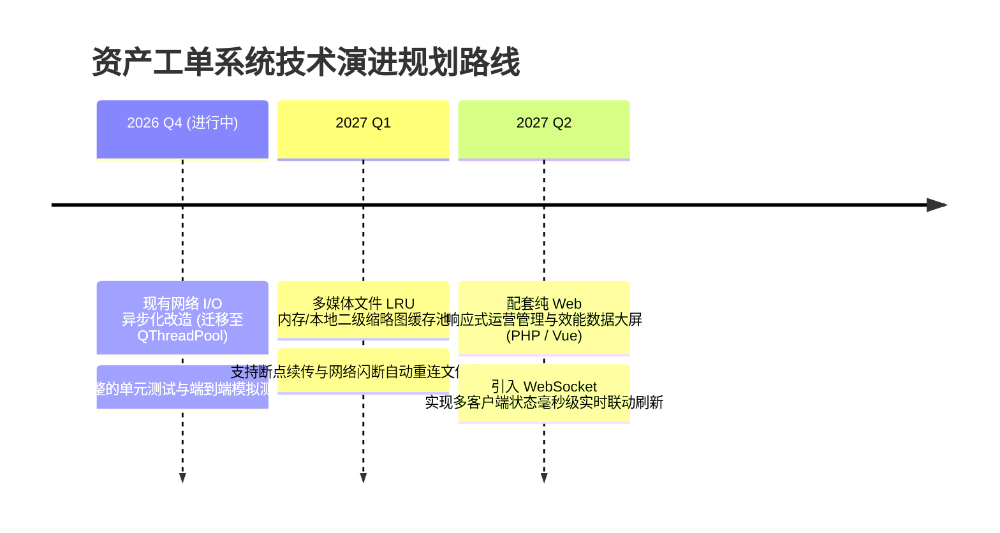

# 资产工单管理系统 (Asset Tickets) 全景深度技术白皮书

> **系统版本**：v1.17.10  
> **文档定位**：全景技术架构、领域模型、业务流转、核心底层机制、安全防御与 DevOps 运维全景白皮书  
> **存储路径**：`docs/PROJECT_DEEP_ANALYSIS.md`  
> **面向对象**：系统架构师、桌面端/后端开发人员、测试工程师及运维人员

---

## 目录

- [一、 项目执行摘要与业务定位](#一-项目执行摘要与业务定位)
- [二、 整体技术拓扑与物理架构](#二-整体技术拓扑与物理架构)
- [三、 数据库实体模型与数据字典全景](#三-数据库实体模型与数据字典全景)
  - [3.1 实体关系图 (Mermaid ER)](#31-实体关系图-mermaid-er)
  - [3.2 核心业务表数据字典](#32-核心业务表数据字典)
  - [3.3 双链并行解耦状态机模型](#33-双链并行解耦状态机模型)
- [四、 8 大角色端到端工作流闭环矩阵](#四-8-大角色端到端工作流闭环矩阵)
- [五、 NAS 共享存储架构与 13 个路径模板契约](#五-nas-共享存储架构与-13-个路径模板契约)
  - [5.1 跨平台路径虚拟化原理](#51-跨平台路径虚拟化原理)
  - [5.2 13 个流转路径 Lambda 模板映射全景表](#52-13-个流转路径-lambda-模板映射全景表)
  - [5.3 资产命名规范与文件清洗机制](#53-资产命名规范与文件清洗机制)
- [六、 外部工单系统集成与网络协议安全](#六-外部工单系统集成与网络协议安全)
  - [6.1 DNS Rebinding 与 SSRF 深度防御体系](#61-dns-rebinding-与-ssrf-深度防御体系)
  - [6.2 Token 双级缓存与动态热加载](#62-token-双级缓存与动态热加载)
  - [6.3 字段编码对照字典与 API 契约](#63-字段编码对照字典与-api-契约)
- [七、 核心底层机制与高可靠性加固设计](#七-核心底层机制与高可靠性加固设计)
  - [7.1 两阶段状态同步与事务补偿回滚 (`status_sync.py`)](#71-两阶段状态同步与事务补偿回滚-status_syncpy)
  - [7.2 QFluentWidgets 跨平台焦点析构崩溃补丁 (`patch_fluent.py`)](#72-qfluentwidgets-跨平台焦点析构崩溃补丁-patch_fluentpy)
  - [7.3 认证防时序攻击加固](#73-认证防时序攻击加固)
  - [7.4 数据库自动重连与并发可重入锁 (`@_db_locked`)](#74-数据库自动重连与并发可重入锁-_db_locked)
  - [7.5 大文件后台传输队列与零丢失校验 (`task_manager.py`)](#75-大文件后台传输队列与零丢失校验-task_managerpy)
- [八、 表现层架构与弹窗解耦模式](#八-表现层架构与弹窗解耦模式)
  - [8.1 闪屏加载与异步初始化生命周期](#81-闪屏加载与异步初始化生命周期)
  - [8.2 业务弹窗调度器与 `callbacks` 通信契约](#82-业务弹窗调度器与-callbacks-通信契约)
- [九、 DevOps 构建打包与运维部署手册](#九-devops-构建打包与运维部署手册)
  - [9.1 资源图标跨环境探测优先级](#91-资源图标跨环境探测优先级)
  - [9.2 客户端构建方案 (Nuitka vs PyInstaller)](#92-客户端构建方案-nuitka-vs-pyinstaller)
  - [9.3 环境变量 (`.env`) 配置全解](#93-环境变量-env-配置全解)
- [十、 系统质量评估与演进路线 (Roadmap)](#十-系统质量评估与演进路线-roadmap)

---

## 一、 项目执行摘要与业务定位

### 1.1 核心痛点与解决策略
**资产工单管理系统 (Asset Tickets)** 专为多媒体密集型电商创意与视频生产团队量身打造。传统 Web 管理系统在处理专业设计与影视资产时存在天然瓶颈：
1. **多媒体素材体积巨大**：4K 高码率视频源片、单反相机 RAW 格式原图（单工单常见数十 GB 甚至数百 GB），通过浏览器上传与下载极易超时中断，严重受制于外网带宽。
2. **多环节并行协作脱节**：拍摄完成后，平面修图（美工组）与动态视频剪辑（视频组）属于两条并行推进的工作线，单一线性工单状态机无法真实反映资产阶段。
3. **状态与实体文件不一致**：常见“系统标记为完成，但目标盘无文件”或“文件转移中途断电导致源文件与目标文件均损坏”。

系统基于 **PySide6 (Qt) 桌面客户端直接与局域网高速 SMB/NFS NAS 共享盘交互**，配合中央 **MySQL** 数据库与上游 ERP/工单接口，构建了“**工单流转驱动文件分发，文件完整性决定状态推进**”的强一致性数字资产协同中枢。

### 1.2 核心技术栈矩阵

| 领域 | 选型组件 | 版本 / 规范 | 职责说明 |
|---|---|---|---|
| **桌面 GUI 框架** | `PySide6` | 6.9.1 | 底层采用 Qt6 C++ 跨平台高性能图形引擎 |
| **界面控件库** | `PySide6-Fluent-Widgets` | >=1.11.0 | 现代 Fluent Design 设计语言组件 |
| **数据库驱动** | `PyMySQL` | 1.1.1 | 纯 Python 实现的 MySQL 客户端，封装线程安全连接池 |
| **中央持久化** | `MySQL` / `MariaDB` | 5.7+ / 10.2+ | 存储工单、日志、产线配置、元数据 |
| **网络与系统监控**| `requests` / `psutil` | 2.32.4 / >=5.9.0| 外部 REST API 交互及本地硬件资源监测 |
| **存储基础设施** | SMB / Windows UNC / POSIX | `\\dabadoc` 或 `/Volumes` | 企业级 NAS 共享存储，资产流转承载体 |
| **消息路由** | 钉钉 / 企业微信 Webhook | HTTP POST | 基于部门独立配置的自动化工作流群通知 |
| **客户端构建** | `nuitka` / `pyinstaller` | >=2.8.10 / >=6.0.0 | C 语言编译单文件或绿色便携包输出 |

---

## 二、 整体技术拓扑与物理架构

系统采用分布式端边协同拓扑，桌面端承担繁重的本地文件 I/O 调度，中央数据库提供一致性凭据，外部系统提供跨组织协同：



---

## 三、 数据库实体模型与数据字典全景

### 3.1 实体关系图 (Mermaid ER)

系统由 10 张核心业务与配置表构成强实体关联网络：



### 3.2 核心业务表数据字典

#### 1. 工单主表 (`mcs_by_takuya_work_orders`)
| 字段名 | 类型 | Null | 默认值 | 约束 / 索引 | 业务含义与说明 |
|---|---|---|---|---|---|
| `id` | `varchar(20)` | NO | 无 | PRIMARY KEY | 工单唯一业务主键（如 `WO2026081401`） |
| `department_id` | `int(11)` | YES | NULL | INDEX, FK | 关联部门，决定文件存储产线子目录与通知群路由 |
| `model` | `varchar(100)` | YES | NULL | - | 产品规格型号/编号（参与目录命名契约） |
| `name` | `varchar(200)` | YES | NULL | - | 产品名称（参与目录命名契约） |
| `creator` | `varchar(100)` | YES | NULL | - | 发起人工位/姓名 |
| `requester` | `varchar(255)` | YES | NULL | - | 业务需求负责人 |
| `type` | `varchar(50)` | YES | NULL | - | 工单大类 |
| `status` | `varchar(20)` | YES | 'pending' | - | **全局主流转状态**（主控视频流与归档） |
| `art_status` | `varchar(20)` | YES | NULL | - | **美工链专属状态**（平面修图业务与主状态完全解耦） |
| `project_type_id` | `int(11)` | YES | NULL | INDEX, FK | 关联 `mcs_by_takuya_project_types.id` |
| `project_content_id` | `int(11)` | YES | NULL | INDEX, FK | 关联 `mcs_by_takuya_project_contents.id` |
| `remarks` | `text` | YES | NULL | - | 工单业务备注、拍摄要点说明 |
| `art_start_time` | `datetime` | YES | NULL | - | 美工首次领取素材开始时间 |
| `art_end_time` | `datetime` | YES | NULL | - | 美工完成精修并提交审批时间 |
| `edit_start_time` | `datetime` | YES | NULL | - | 剪辑首次领取视频素材开始时间 |
| `edit_end_time` | `datetime` | YES | NULL | - | 剪辑成片完成并提交后期审核时间 |
| `created_at` | `timestamp` | NO | CURRENT_TIMESTAMP | - | 工单系统内创建时间 |
| `updated_at` | `timestamp` | NO | CURRENT_TIMESTAMP (ON UPDATE) | - | 记录最后修改时间（用于高并发乐观锁比对） |

#### 2. 电商物料扩展表 (`mcs_by_takuya_product_info`)
| 字段名 | 类型 | Null | 默认值 | 约束 | 业务说明 |
|---|---|---|---|---|---|
| `id` | `int(11)` | NO | 自增 | PRIMARY KEY | 主键 |
| `work_order_id` | `varchar(20)` | YES | NULL | INDEX, FK | 外键关联工单，配置 `ON DELETE CASCADE` 级联删除 |
| `title` | `varchar(255)` | NO | 无 | - | 上架商品标题 |
| `keywords` | `varchar(500)` | NO | 无 | - | 商品检索与埋点 SEO 核心词 |
| `url` | `varchar(500)` | NO | 无 | - | 商品在淘宝/京东/独立站的前台真实链接 |

#### 3. 全局审计日志表 (`mcs_by_takuya_logs`)
| 字段名 | 类型 | Null | 默认值 | 约束 | 业务说明 |
|---|---|---|---|---|---|
| `id` | `int(11)` | NO | 自增 | PRIMARY KEY | 日志主键 |
| `role` | `varchar(50)` | YES | NULL | - | 触发动作的操作角色名称（摄影/美工/剪辑等） |
| `action` | `varchar(255)` | YES | NULL | - | 行为动作摘要（如“提交审核”、“分发至素材中心”） |
| `action_type` | `varchar(50)` | YES | '' | - | 动作分类标记（CREATE / UPDATE / DELETE / TRANSFER） |
| `user_name` | `varchar(64)` | YES | '' | - | 操作人真实姓名 |
| `ip_address` | `varchar(45)` | YES | 'N/A' | - | 客户端内网 IPv4 / IPv6 地址 |
| `details` | `text` | YES | NULL | - | 结构化审计明细（源路径、目标路径、文件统计、异常栈） |
| `timestamp` | `timestamp` | NO | CURRENT_TIMESTAMP | - | 操作发生精确时刻 |

---

### 3.3 双链并行解耦状态机模型

在电商多媒体工业化生产中，摄影师完成样机拍摄后，**美工团队（输出高清主图/详情页）**与**视频团队（输出 15s 短视频/产品展示视频）**的生产节拍完全不同。如果使用单字段状态机，往往会出现“美工已修完图，但因视频还没剪好导致工单卡在‘处理中’，运营无法提前上架商品主图”的严重脱节。

系统在底层将两者拆分为**独立推进、异步汇合**的双链状态机：



---

## 四、 8 大角色端到端工作流闭环矩阵

系统中共有 8 个标准业务角色，各角色在 UI 层均拥有专属流转弹窗（位于 [`src/ui/process_dialogs/`](file:///e:/2025/pyproj/src/ui/process_dialogs)），统一遵循输入前置校验、文件转移、状态跃迁、钉钉/企微消息广播的闭环机制：

| 角色序号与名称 | UI 处理模块 | 准入前置状态 | 核心交互与操作动作 | NAS 文件流转过程 | 数据库状态与时间戳跃迁 | 通知广播模板 | 异常退回机制 |
|---|---|---|---|---|---|---|---|
| **1. 采购 / 摄影** | [`photography.py`](file:///e:/2025/pyproj/src/ui/process_dialogs/photography.py) | `pending` 或 `uploaded` | 选择摄影师；上传本地单反卡文件；分发素材给美工与视频 | 客户端本地 -> `PHOTOGRAPHY_UPLOAD` -> 分发至 `PHOTOGRAPHY_DIST_IMG` 与 `PHOTOGRAPHY_DIST_VIDEO` | `status` -> `uploaded`<br>写 `photographer_start/end_time` | 广播：摄影已上传，美工与视频组待领取 | 视频初审不通过时，工单退回，摄影师收到重新补拍提醒 |
| **2. 视频初审** | [`video_review.py`](file:///e:/2025/pyproj/src/ui/process_dialogs/video_review.py) | `video_reviewing` | 内置播放器双击预览视频源片；填写审核意见；点击“通过”或“退回” | 源片保留在待领取目录；退回时在源目录生成退回反馈说明文档 | 审核通过：`status` -> `video_reviewed`<br>退回：`status` -> `uploaded` | 广播审核结果；通过时通知剪辑组；退回通知摄影师 | 点击退回弹出拒绝原因输入框，自动清除通过标记 |
| **3. 视频剪辑** | [`editing.py`](file:///e:/2025/pyproj/src/ui/process_dialogs/editing.py) | `video_reviewed` 或 `editing` | 领取视频源片；本地剪辑合成成片；上传成片到待审批区 | 从 `EDIT_GET_VIDEO_SRC` 移动至本地剪辑库；剪辑完毕复制至 `EDIT_POST_REVIEW_TRANSIT` | 领取：`status` -> `editing`, 写 `edit_start_time`<br>完成：`status` -> `video_post_reviewing`, 写 `edit_end_time` | 广播剪辑完成成片，通知视频后期审核员 | 支持在弹窗内撤回已提交的剪辑成片 |
| **4. 视频后期审核** | [`video_post_review.py`](file:///e:/2025/pyproj/src/ui/process_dialogs/video_post_review.py) | `video_post_reviewing` | 逐帧审查剪辑成片字幕、调色与画质；审核通过或驳回重剪 | 审核通过：自动分发成片到 `EDIT_DIST_OPS` 与 `EDIT_DIST_SALES` | `status` -> `completed` | 广播视频最终完工，运营/销售可用 | 驳回时成片打上 `不通过` 标记，退回剪辑师待处理区 |
| **5. 美工精修** | [`art.py`](file:///e:/2025/pyproj/src/ui/process_dialogs/art.py) | `uploaded` (无视视频状态) | 领取修图图片源文件；Photoshop 修图；上传成品图至待审目录 | 从 `ART_GET_IMG_SRC` 领取至 `ART_GET_IMG_DEST`；修完移至 `ART_POST_REVIEW_TRANSIT` | 领取：`art_status` -> `processing`, 写 `art_start_time`<br>提交：`art_status` -> `reviewing`, 写 `art_end_time` | 广播美工修图完毕，通知美工主管审批 | 审核驳回时重新进入 `processing` |
| **6. 美工后期审批** | [`art_post_review.py`](file:///e:/2025/pyproj/src/ui/process_dialogs/art_post_review.py) | `art_status == reviewing` | 图像差异对比审查（主图/白底/场景图）；点击“通过”或“退回修改” | 审核通过：自动从中转区移动到 `ART_DIST_OPS` 与 `ART_DIST_SALES` | `art_status` -> `completed` | 广播美工成品就绪，通知运营与销售部 | 驳回时将成品移动至待修改目录，重置 `art_status` 为 `rejected` |
| **7. 运营部** | [`ops.py`](file:///e:/2025/pyproj/src/ui/process_dialogs/ops.py) | `status==completed` 或 `art_status==completed` | 查看并提取素材中心资产；维护并提交电商标题、关键词及上架链接 | 读取 `OPS_GET_SRC` 目录；双击可直接在 Windows Explorer 打开目标路径 | 维护 `mcs_by_takuya_product_info` 表；写操作日志 | 广播：商品已完成上架配置，更新对应链接 | 若素材有误可反向提交“重新修图/剪辑”反馈单 |
| **8. 销售部** | [`sales.py`](file:///e:/2025/pyproj/src/ui/process_dialogs/sales.py) | 任意有成品素材的阶段 | 浏览产品成片与渲染图；一键批量打包导出至本地营销推广库 | 只读读取 `SALES_GET_SRC` 并通过 `TaskManager` 复制到本地工作盘 | 记录销售端素材下载与使用审计日志 | 无群广播，只记内审日志 | 发现画质或内容缺失，提交工单需求修正意见 |

---

## 五、 NAS 共享存储架构与 13 个路径模板契约

### 5.1 跨平台路径虚拟化原理

系统客户端支持 Windows 与 macOS 双系统。在 Windows 下，企业 NAS 通过 UNC 规范访问（如 `\\dabadoc\01原始素材`）；在 macOS 下，系统通过 SMB 自动挂载至 `/Volumes`（如 `/Volumes/01原始素材`）。

[`src/core/paths.py`](file:///e:/2025/pyproj/src/core/paths.py) 实现了全系统路径的**双向规范化解析**：
```python
def to_local_path(path_str: str) -> str:
    """跨平台路径格式翻译（适配 Windows 的 \\\\dabadoc 和 macOS 的 /Volumes）"""
    norm_path = path_str.replace('\\', '/')
    if platform.system() == 'Windows':
        if norm_path.startswith('/Volumes'):
            local_path = norm_path.replace('/Volumes', r'\\dabadoc', 1)
        else:
            local_path = norm_path
        return os.path.normpath(local_path)
    else:
        # macOS 平台
        if norm_path.startswith(('//dabadoc', '//DABADOC')):
            local_path = re.sub(r'^//[dD][aA][bB][aA][dD][oO][cC]', '/Volumes', norm_path)
        else:
            local_path = norm_path
        return os.path.normpath(local_path).replace('\\', '/')
```

### 5.2 13 个流转路径 Lambda 模板映射全景表

全系统所有模块（包含工单创建、文件搬运、审核预览、清理）**严禁手动拼写路径**，必须调用 [`src/core/paths.py`](file:///e:/2025/pyproj/src/core/paths.py) 中的 13 个统一 Lambda 模板：

| 序号 | 模板名称 (Lambda 标识符) | 逻辑归属阶段 | 参数契约 (`dept, id_, model, name...`) | 目标网络盘相对目录结构 |
|---|---|---|---|---|
| **1** | `PHOTOGRAPHY_UPLOAD` | 摄影上传 | `(photographer, dept, id_, model, name)` | `01原始素材/01原始素材/{photographer}/{dept}/{id_} {model} {name}` |
| **2** | `PHOTOGRAPHY_DIST_IMG` | 摄影分发图片 | `(dept, id_, model, name)` | `01原始素材/02美工待领取/{dept}/01图片/{id_} {model} {name}` |
| **3** | `PHOTOGRAPHY_DIST_VIDEO`| 摄影分发视频 | `(dept, id_, model, name)` | `01原始素材/02美工待领取/{dept}/02视频/{id_} {model} {name}` |
| **4** | `ART_GET_IMG_SRC` | 美工提取图片源 | `(dept, id_, model, name)` | `01原始素材/02美工待领取/{dept}/01图片/{id_} {model} {name}` |
| **5** | `ART_GET_IMG_DEST` | 美工待处理工坊 | `(dept, id_, model, name)` | `02图像部/01美工部/{dept}/00待处理/{id_} {model} {name}` |
| **6** | `ART_POST_REVIEW_TRANSIT`| 美工待审批中转 | `(dept, id_, model, name)` | `02图像部/01美工部/{dept}/01待审批/{id_} {model} {name}` |
| **7** | `ART_DIST_OPS` | 美工交付运营 | `(dept, id_, model, name)` | `03素材中心/01运营部/{dept}/{id_} {model} {name}` |
| **8** | `ART_DIST_SALES` | 美工交付销售 | `(dept, id_, model, name)` | `03素材中心/02销售部/{dept}/{id_} {model} {name}` |
| **9** | `EDIT_GET_VIDEO_SRC` | 剪辑提取视频源 | `(dept, id_, model, name)` | `01原始素材/02美工待领取/{dept}/02视频/{id_} {model} {name}` |
| **10**| `EDIT_GET_VIDEO_DEST` | 剪辑待处理工坊 | `(dept, id_, model, name)` | `02图像部/02视频部/{dept}/00待处理/{id_} {model} {name}` |
| **11**| `EDIT_POST_REVIEW_TRANSIT`| 剪辑待审核中转 | `(dept, id_, model, name)` | `02图像部/02视频部/{dept}/01待审核/{id_} {model} {name}` |
| **12**| `EDIT_DIST_OPS` | 剪辑交付运营 | `(dept, id_, model, name)` | `03素材中心/01运营部/{dept}/{id_} {model} {name}/02视频` |
| **13**| `EDIT_DIST_SALES` | 剪辑交付销售 | `(dept, id_, model, name)` | `03素材中心/02销售部/{dept}/{id_} {model} {name}/02视频` |

此外，系统还提供辅助定位模板：
- `OPS_GET_SRC(dept, id_, model, name)`：指向 `03素材中心/01运营部/{dept}/{id_} {model} {name}`；
- `SALES_GET_SRC(dept, id_, model, name)`：指向 `03素材中心/02销售部/{dept}/{id_} {model} {name}`。

### 5.3 资产命名规范与文件清洗机制

1. **目录命名契约**：
   - 所有流转目录末级文件夹严格遵循公式：`f"{id_} {model} {name}"`；
   - 空格作为分隔符，不允许使用特殊非法字符（如 `\ / : * ? " < > |`），在创建前通过正则表达式自动清洗。
2. **多媒体扩展名白名单**：
   - 图片支持：`IMG_EXTS = {'.jpg', '.jpeg', '.png', '.bmp', '.gif', '.tif', '.tiff', '.webp', '.heic', '.raw', '.arw', '.cr2', '.nef', '.raf', '.dng', '.cr3' ...}`
   - 视频支持：`VID_EXTS = {'.mp4', '.mov', '.avi', '.wmv', '.flv', '.mkv', '.webm', '.m4v', '.ts' ...}`
3. **系统级无用文件自动过滤与清洗 ([`path_check.py`](file:///e:/2025/pyproj/src/ui/path_check.py))**：
   - macOS 访问 SMB 盘时会自动生成隐藏的资源分叉文件（如 `._*`、`.DS_Store`），Windows 会生成 `Thumbs.db`、`desktop.ini`；
   - 系统在执行文件数量统计、复制移动、完整性校验时，自动将这些特征文件加入黑名单剔除，避免其影响工单完成度的统计，并在管理员体检工具中提供一键递归擦除功能。

---

## 六、 外部工单系统集成与网络协议安全

系统客户端需与企业内部上游 ERP/工单系统（运行于 `http://192.168.0.54:13000`）进行工单创建与时间节点双向同步。在 [`src/core/api_manager.py`](file:///e:/2025/pyproj/src/core/api_manager.py) 中实施了严苛的安全与协议控制。

### 6.1 DNS Rebinding 与 SSRF 深度防御体系

外部请求发送函数 `_post_api(url, ...)` 具备企业级安全校验：
```python
_API_ALLOWED_HOSTS = {'192.168.0.54'}
_API_ALLOWED_SCHEMES = ('http', 'https')

def _safe_api_url(url: str) -> str | None:
    parsed = urllib.parse.urlparse(url)
    if parsed.scheme not in _API_ALLOWED_SCHEMES or parsed.hostname not in _API_ALLOWED_HOSTS:
        return None
    # 强制将 Host 解析为底层 IP 并验证是否完全在白名单内（杜绝通过本地 DNS 解析重定向实施 DNS Rebinding 攻击）
    allowed_ips = {ipaddress.ip_address(ip) for ip in _API_ALLOWED_HOSTS}
    resolved_ips = {ipaddress.ip_address(addr[4][0]) for addr in socket.getaddrinfo(parsed.hostname, None)}
    if not resolved_ips or not resolved_ips.issubset(allowed_ips):
        return None
    return parsed._replace(fragment='').geturl()
```
同时在 `requests.post` 调用中强制设置 `allow_redirects=False`，防止上游服务端返回 301/302 重定向诱导客户端发起针对任意内网地址的 SSRF 扫描。

### 6.2 Token 双级缓存与动态热加载

调用外部接口依赖 Bearer Token。系统采用“**数据库配置优先，环境变量兜底，支持实时热清空**”的双级缓存模式：
1. **优先读取数据库**：`db_manager.get_system_setting('api_token')`（管理员可在桌面端“系统设置”页面随时换绑 Token，无需重启所有客户端）；
2. **环境变量回退**：若数据库为空，回退至 `.env` 中的 `API_TOKEN`；
3. **热失效回调**：管理员在设置界面保存新 Token 时，触发 `refresh_api_token_cache()`，令内存全局缓存 `_token_cache = None`，下一次请求即刻生效。

### 6.3 字段编码对照字典与 API 契约

外部系统采用动态字段编码（如 `f_xxxx`）。为了杜绝多处硬编码映射导致的版本分叉，系统在 [`src/core/api_manager.py`](file:///e:/2025/pyproj/src/core/api_manager.py) 中维护统一定义：

```python
# 字段与时间戳映射字典 (TIME_FIELD_MAP)
TIME_FIELD_MAP = {
    'start_time': 'f_iis2qlzmmko',              # 工单开始时间戳
    'end_time': 'f_4civ803ubaz',                # 工单完结时间戳
    'photographer_start_time': 'f_8ufkn1d1z3v', # 摄影领取时间戳
    'photographer_end_time': 'f_augkx557xwf',   # 摄影上传时间戳
    'art_start_time': 'f_n9vu52g0c4f',          # 美工开工时间戳
    'art_end_time': 'f_pkcr94xo1py',            # 美工完工时间戳
    'edit_start_time': 'f_vyp0iizeom5',         # 剪辑开工时间戳
    'edit_end_time': 'f_6aocwxxqcfj',           # 剪辑完工时间戳
}

# 工单属性编码
# id             -> 业务工单ID
# f_emd69kip4gk  -> 产品型号
# f_ifa9xxyrmft  -> 产品名称
# f_jxzzjg7egqm  -> 需求人/负责人
# f_utqw1679w43  -> 工单状态字符串
# f_ay6dm3j0pfz  -> 项目类型名称 (从 DB 反查)
# f_a9q7rpf5paj  -> 项目内容名称 (从 DB 反查)
```

---

## 七、 核心底层机制与高可靠性加固设计

### 7.1 两阶段状态同步与事务补偿回滚 (`status_sync.py`)

在跨系统状态推进时，网络中断是不可避免的。若“本地 MySQL 更新为已完成，但外部 API 调用超时”，两端系统将产生永久数据不一致。

系统在 [`src/core/status_sync.py`](file:///e:/2025/pyproj/src/core/status_sync.py) 实现了两阶段补偿机制：
1. **基于 `version` 的乐观锁防护**：
   - 写入前读取当前记录版本号；
   - 执行 `update_work_order_fields(..., expected_version=version)`；
   - 若 `rowcount == 0`，代表在读取与写入的毫秒窗口期内已被其他同事修改，系统立即抛出版本冲突提示并终止后续外部网络调用，避免静默脏写覆盖。
2. **两阶段原子写入与补偿回滚**：
   ```mermaid
   sequenceDiagram
       autonumber
       participant UI as 角色流转弹窗
       participant Sync as status_sync 引擎
       participant DB as 本地 MySQL
       participant API as 外部 ERP API

       UI->>Sync: update_status_with_api(order_id, new_status, old_status, ...)
       Sync->>DB: 阶段一: 乐观锁写入新状态 (status/art_status/时间戳)
       alt 本地写库失败或版本冲突
           DB-->>Sync: 写入失败 (rowcount <= 0)
           Sync-->>UI: 返回 (False, "版本冲突或写库异常")
       else 本地写入成功
           DB-->>Sync: 写入成功
           Sync->>API: 阶段二: 调用 HTTP API 同步状态
           alt 外部 API 调用成功 (HTTP 200)
               API-->>Sync: Success
               Sync-->>UI: 返回 (True, "") [状态流转完成]
           else 外部 API 调用失败或网络超时
               API-->>Sync: HTTP Timeout / Error
               Sync->>DB: 触发补偿回滚: 将字段逐一恢复为 old_status 等
               alt 回滚执行成功
                   DB-->>Sync: Rollback OK
                   Sync-->>UI: 返回 (False, "API更新失败，本地已安全回滚")
               else 回滚异常
                   DB-->>Sync: Rollback Error
                   Sync-->>UI: 返回 (False, "API更新失败且本地回滚失败(严重错误)")
               end
           end
       end
   ```

### 7.2 QFluentWidgets 跨平台焦点析构崩溃补丁 (`patch_fluent.py`)

在 macOS 与 Linux 平台下，由于 Qt 底层事件循环机制差异，用户关闭含有 `RoundMenu`、`ComboBoxMenu` 或 `AcrylicMenu` 的模态对话框时，Qt C++ 层的 `focusOutEvent` 会在 Python 包装对象已析构后继续向野指针投递焦点事件，导致严重的底层段错误（`SIGSEGV` / `EXC_BAD_ACCESS`）闪退。

系统编写了运行时猴子补丁 [`src/core/patch_fluent.py`](file:///e:/2025/pyproj/src/core/patch_fluent.py)，在程序启动最早期（`main.py`）应用：
```python
def _clear_menu_focus(menu_obj):
    """安全清空菜单及其内部子视图焦点，切断析构时的焦点回调链路"""
    try:
        if hasattr(menu_obj, 'view') and menu_obj.view:
            menu_obj.view.clearFocus()
        menu_obj.clearFocus()
        focused = QApplication.focusWidget()
        if focused and (focused is menu_obj or (hasattr(menu_obj, 'view') and focused is menu_obj.view) or menu_obj.isAncestorOf(focused)):
            focused.clearFocus()
    except Exception:
        pass
```
通过拦截菜单的 `hideEvent` 与组合框的弹出关闭事件，在视图隐藏时主动清理 C++ 焦点，彻底根治了跨平台模态窗口偶发闪退的顽疾。

### 7.3 认证防时序攻击加固

系统管理员登录认证涉及敏感操作（工单物理删除、系统日志清空、Token 换绑）。
- **拒绝未配置空密码**：若环境变量未配置 `ADMIN_PASSWORD`，严禁以空密码直接登录，必须明确报错阻止入口开启；
- **恒定时间比较**：在 [`src/ui/character_selection.py`](file:///e:/2025/pyproj/src/ui/character_selection.py) 中，放弃普通的 `password == ADMIN_PASSWORD` 字符串逐字符比较（存在微秒级响应时间差泄露密码长度和字符的风险），改用 Python 标准库内置的 `hmac.compare_digest(password, ADMIN_PASSWORD)`，以恒定时间算法彻底免疫侧信道时序攻击（Timing Attack）。

### 7.4 数据库自动重连与并发可重入锁 (`@_db_locked`)

桌面客户端生命周期通常长达数天甚至数周，长时间闲置会导致 MySQL 服务端超时掐断 Socket（`MySQL server has gone away`，错误码 2006/2013）。

1. **活性探测与指数重试**：
   - 每次执行 SQL 查询前，调用 `_ensure_connection()` 探测连接活性；若已失效，自动执行 Ping 重连或重建连接，调用方业务层无感知。
2. **并发可重入锁 (`@_db_locked`)**：
   - 客户端内部包含 UI 主线程、后台加载线程 `StartupLoaderWorker`、任务扫描线程 `TaskWorker` 等；
   - PyMySQL 底层基于单一 Socket 通信，多线程同时读写同一个 Socket 会导致 MySQL 数据帧乱序；
   - 系统为 [`src/core/database.py`](file:///e:/2025/pyproj/src/core/database.py) 的 `DatabaseManager` 单例全部公开方法加装 `@_db_locked` 装饰器，底层使用 `threading.RLock()` 串行化访问，杜绝了多线程竞争引起的协议损坏。

### 7.5 大文件后台传输队列与零丢失校验 (`task_manager.py`)

多媒体资产单次移动可能涉及数百个文件。在文件移动（Move）模式下，若采用“目标文件存在即跳过并删除源文件”的策略，一旦目标端存在的是上一次中途取消产生的**损坏/不完整残卷**，删除源文件将导致用户资产的**永久性毁灭**。

系统在 [`src/ui/task_manager.py`](file:///e:/2025/pyproj/src/ui/task_manager.py) 中实施了严密的等价性校验：
1. **移动前完整性核验**：
   - 若目标文件已存在，绝不单纯比对文件名；
   - 严格比对文件类型（`os.path.isfile` vs `os.path.isdir`）以及精确的文件字节数大小（`os.path.getsize`）；
   - 只有在目标文件存在且字节数与源文件**完全一致**时，才判定为有效副本；否则强制覆盖重传。
2. **后置安全擦除**：
   - 只有在文件内容全部传输完毕且校验无误后，才将源文件加入待删除列表；
   - 任务信号携带 `(ok: bool, errors: list)`；一旦中途出现任何 I/O 错误，`ok` 标记置为 `False`，**立即中止删除源文件，同时中止上层的工单状态推进与通知发送**，确保文件安全与状态一致。
3. **线程生命周期可控释放**：
   - 对话框关闭时（`closeEvent`），主动调用 `requestInterruption()`，并在 5 秒超时窗口内通过 `wait(5000)` 回收工作线程，防止内存泄漏与 C++ 悬挂指针崩溃。

---

## 八、 表现层架构与弹窗解耦模式

### 8.1 闪屏加载与异步初始化生命周期

为了避免启动时主窗口加载大量数据导致界面长时间白屏假死，客户端采用了多阶段流畅启动架构：



### 8.2 业务弹窗调度器与 `callbacks` 通信契约

在业务主窗口 [`src/ui/main_window.py`](file:///e:/2025/pyproj/src/ui/main_window.py) 与具体的角色业务弹窗之间，系统彻底摈弃了“将主窗口 `self` 传给弹窗供其随意调用主窗私有属性”的强耦合反模式。

1. **门面分发器 ([`dispatcher.py`](file:///e:/2025/pyproj/src/ui/process_dialogs/dispatcher.py))**：
   - 外部调用仅需一行：`show_process_order_dialog(role, parent, order_data, callbacks)`；
   - 内部字典维护了角色与弹窗工厂函数的映射，支持动态扩展新角色而无需改动主窗口核心框架。
2. **标准 `callbacks` 契约字典**：
   ```python
   callbacks = {
       'on_refresh': self.refresh_table,                # 任务完成后刷新列表
       'add_task': self.task_manager.add_task,          # 委派大文件异步后台传输
       'show_notice': self.show_notification,           # 弹出 Fluent 样式通知
       'log_action': self.db.log_action,                # 记录审计日志
       'get_user_info': lambda: self.current_user_info  # 提取当前登录会话
   }
   ```
   弹窗仅依赖明确的回调签名，保证了业务弹窗可进行高度独立的单元测试和模块重构。

---

## 九、 DevOps 构建打包与运维部署手册

### 9.1 资源图标跨环境探测优先级

应用打包成单个可执行文件后，静态资源（如 `app_icon.ico`、`logo-*.png`）在不同平台和打包工具下的解压路径大相径庭。[`src/main.py`](file:///e:/2025/pyproj/src/main.py) 中的 `_resolve_icon_path()` 建立了严密的多级查找梯队：
1. **PyInstaller 运行时临时解压目录**：`getattr(sys, '_MEIPASS', None)`；
2. **可执行文件同级目录**：`sys.executable` 所在目录（Nuitka 目录构建模式）；
3. **macOS App Bundle 资源包目录**：`../Contents/Resources/`；
4. **入口脚本所在目录**：`sys.argv[0]` 所在目录；
5. **源码项目根目录与当前工作目录 (`os.getcwd()`)**。

在 Windows 平台下，启动时显式注册专属应用标识符：
```python
ctypes.windll.shell32.SetCurrentProcessExplicitAppUserModelID("takuya.material.workorder.system")
```
确保无论在任务栏固定、多窗口重叠还是通知中心，均能准确渲染系统独立应用图标，而非显示通用的 Python 终端图标。

### 9.2 客户端构建方案 (Nuitka vs PyInstaller)

| 对比维度 | Nuitka 方案 (建议生产环境) | PyInstaller 方案 (建议内部测试) |
|---|---|---|
| **构建原理** | 将 Python 源码深度转译为 C++ 代码并调用宿主编译器编译为原生机器码 | 将 Python 解释器、依赖 wheel 与 bytecode 简单解压打包入同一容器 |
| **执行性能** | 运算启动耗时缩短 30%~50%，内存开销更低 | 启动需在 `_MEIPASS` 解压临时文件，初次启动稍慢 |
| **源码防护能力** | 极高（已完全编译为原生二进制机器指令，逆向难度等同于 C++） | 较低（可通过 pyinstxtractor 反编译提取 pyc 源码） |
| **构建推荐命令** | `nuitka --standalone --onefile --enable-plugin=pyside6 --windows-icon-from-ico=app_icon.ico main.py` | `pyinstaller -F -w -i app_icon.ico main.py` |
| **推荐 Python 版本**| **Python 3.11**（对 PySide6 扩展支持最稳定） | **Python 3.12+** |

### 9.3 环境变量 (`.env`) 配置全解

客户端与服务端通过根目录 `.env` 文件进行动态解耦配置（可基于 `.env.example` 复制）：

```ini
# ---------------------------------------------------------------------------
# 数据库核心连接配置
# ---------------------------------------------------------------------------
DB_HOST=192.168.0.54            # MySQL 服务器内网地址
DB_PORT=3306                    # MySQL 服务端口
DB_NAME=mcs_by_takuya           # 工单系统专用数据库库名
DB_USER=mcs_user                # 数据库访问账号
DB_PASSWORD=your_db_password    # 数据库访问密码

# ---------------------------------------------------------------------------
# 系统安全与管理员鉴权
# ---------------------------------------------------------------------------
ADMIN_PASSWORD=your_admin_secret_key # 管理员特权控制台登录密码 (必须配置强密码)

# ---------------------------------------------------------------------------
# 外部系统 API 接口集成
# ---------------------------------------------------------------------------
API_TOKEN=your_erp_api_token_here    # 上游 ERP/工单系统调用凭证 Bearer Token
API_BASE_URL=http://192.168.0.54:13000 # 外部工单系统服务主机基地址

# ---------------------------------------------------------------------------
# 调试开关与日志控制
# ---------------------------------------------------------------------------
BYPASS_VIDEO_POST_REVIEW_STATUS_CHECK=false # 是否跳过视频后期审核的状态强校验 (用于测试排障)
LOG_LEVEL=INFO                              # 本地控制台日志级别 (DEBUG / INFO / WARNING / ERROR)
```

---

## 十、 系统质量评估与演进路线 (Roadmap)

### 10.1 现有系统质量评价与优势
1. **工业级鲁棒性**：经历了多轮严格的全量代码审查，消除了大文件转移时的静默丢失隐患、管理员认证的时序攻击风险，并在底层完成了可重入线程锁与乐观锁并发控制。
2. **极佳的业务贴合度**：深度理解多媒体生产流水线，双链并行状态机彻底释放了美工与视频团队的并行生产力。
3. **低运维与高一致性**：通过集中式 SMB 路径模板计算与统一的跨系统状态同步封装，杜绝了多平台下的路径裂脑。

### 10.2 后续架构演进建议 (Roadmap)



1. **主线程网络 I/O 的完全异步化**：
   - 目前部分外部 HTTP API 调用与共享盘目录存在性探测仍在主线程中偶发执行，在局域网波动时容易出现短暂掉帧；建议全面接入 `QThreadPool` / `QRunnable` 并通过信号槽驱动刷新。
2. **高性能缩略图与多媒体缓存池**：
   - 在高分辨率图片与大型视频流预览时，可引入本地临时目录或内存的 LRU 缩略图缓存，翻阅工单列表时无需实时反复跨网络读取 NAS。
3. **基于 WebSocket 的多端实时联动通知**：
   - 目前各客户端依赖手动刷新或定时轮询获取最新工单状态，未来可引入轻量级长连接通知总线，一旦某角色推进工单，其他所有协同人员的桌面端列表自动无感实时刷新。

---

*白皮书编制完成：2026-10-08 · 基于项目全部 25 个 Python 核心源码、数据库 DDL 及安全审计基线全面提炼*
